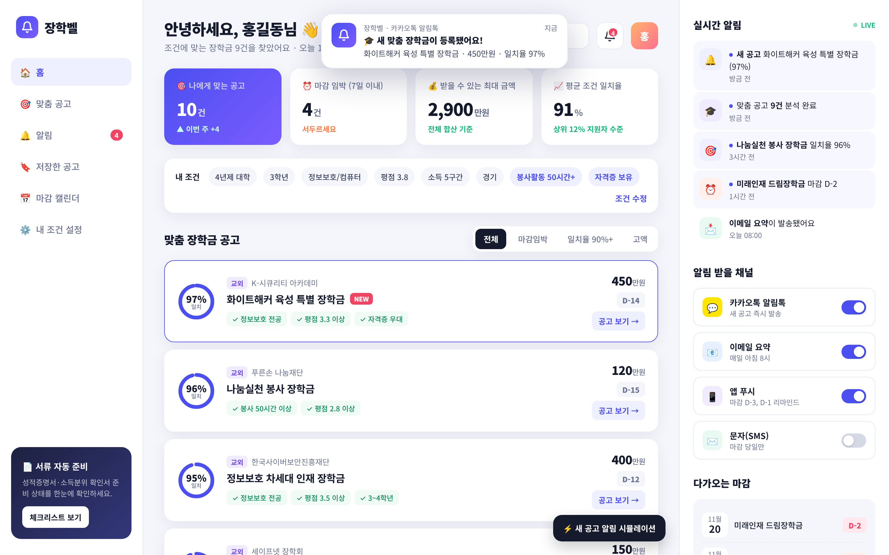

# 🔔 장학벨 (ScholarBell) — 맞춤 장학금 알리미 MVP

내 조건(학년·전공·평점·소득구간·거주지·특이사항)을 한 번 등록하면,
조건에 맞는 장학금 공고를 찾아 **조건 일치율**과 함께 보여주고 새 공고가 올라오면 **알림**을 보내는 서비스의 프로토타입입니다.

> ⚠️ 발표용 데모입니다. 장학금·기관·금액은 예시 데이터입니다.

## 주요 화면
| 조건 설정 | 맞춤 공고 대시보드 | 새 공고 알림 |
|---|---|---|
|  |  |  |

## 기능
- 3단계 조건 설정 (학적 → 성적·소득 → 지역·추가조건)
- 조건 기반 매칭 및 일치율(%) 계산, 일치 근거 태그 표시
- 요약 지표: 맞춤 공고 수, 마감 임박, 최대 수혜 금액, 평균 일치율
- 새 공고 실시간 알림(카카오 알림톡 형태), 알림 채널 설정, 마감 캘린더

## 기술 스택
- HTML / CSS / JavaScript (프레임워크·서버 없음, 단일 파일)

## 실행
`index.html`을 브라우저로 열면 됩니다.

## 향후 확장
- 장학금 공고 자동 수집 크롤러 (한국장학재단·지자체·교내 공지)
- 사용자 조건 저장 DB 및 매칭 배치
- 카카오 알림톡 / 이메일 발송 API 연동
